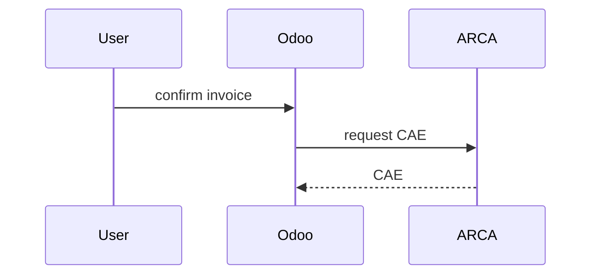

<!--
  Started from `pr` in mattpocock/skills (skills/engineering/pr), merged with the body rules that
  used to live in docs/agents/pull-requests.md. That doc keeps the title rule, the evidence
  mechanics and babysitting; the body is defined here.
-->

# PR body

PRs are squash-merged: the title becomes the commit subject (Conventional Commits, see
[pull-requests.md](../../../docs/agents/pull-requests.md)), and the issue is the record of why.
The body is for the reviewer, who has the diff open. Write it in this template and stop:

```markdown
<anything the reviewer must do or decide, first; omit when there is nothing>

## Summary

<the problem in one or two sentences, then the fix: a short paragraph or a few bullets, and a
picture when the point is structure or order>

## Evidence

- **Before:** <test failure, output, or the printed document before the change>
  **After:** <passing test run, output, or the same document after>

## Merge Danger

**Door:** <one-way or two-way>

<optional: what a revert does not undo>

**Blast Radius:** <one or two words>

<optional: what breaks, and for whom, if the change is wrong>

Closes #N
```

## Rules

- **Do not restate the issue.** The investigation, the alternatives and the domain reasoning live
  in the issue or an ADR. Link them; a reviewer who wants them follows the link.
- **Anything the reviewer must do or decide goes first**, above `## Summary`: a module to upgrade, a
  setting to change, a call that is theirs.
- **One concern per PR.** If the description needs the word "also", it is two PRs. A PRD PR is
  the deliberate exception (below).
- **`Closes #N`** closes the issue on merge
  ([issue-tracker.md](../../../docs/agents/issue-tracker.md#closing-an-issue)).
- English. Spanish only inside backticks, as data, or where a term is the user-facing one. Use the
  domain's terms from `CONTEXT.md`.
- Skip preambles and keep prose brief. Name a symbol or a file only when the reviewer would not
  find it alone.

## Summary

Say what was wrong or missing, as the user or the maintainer would see it, then what changed and,
when it is not obvious from the diff, why this way. A bullet that runs past three lines is a sign
that a picture would have been shorter.

When the point of the fix is structure or order, pick the smallest view that makes it clear:

- Logic or an algorithm as pseudocode:

```text
on_confirm(invoice)
  if invoice has a CAE
    raise: already authorised
  request CAE from ARCA
  store CAE and number
```

- Runtime control flow as a call tree:

```text
action_confirm
  _check_fiscal_position
    _compute_taxes
  _request_cae
  _post_chatter
```

- Module responsibility or a broad refactor as a shallow file tree:

```text
prototype/addons/
├── pcp_pricing/     # price lists and discounts
└── pcp_retail/      # point-of-sale flows
```

- Interaction or data flow with Mermaid:



- `diff` when the point is what changes and the surrounding shape already exists. Match the diff
  shape to the topic:

```diff
 def action_confirm(self):
-    self.write({"state": "posted"})
+    if self.cae:
+        raise UserError(_("Already authorised."))
+    self.write({"state": "posted"})
```

- The whole block when most of it is new, when omitted context would hide ownership or order, or
  when the reviewer needs a copyable target shape.

Place each visual next to the sentence it supports, keep only the calls, files, fields, states and
boundaries the point needs, and use one, rarely two.

## Evidence

Concrete evidence that the change works, as a before and after.

- **A test** is the best evidence: name it and say it failed without the change. A list of green
  commands is a claim, not a before and after.
- **Printed or rendered output** when the change is visual: the before and after text of a report
  or document, against the local copy's data. Pcp has no screenshot tooling yet, so a screenshot
  is attached by hand if the reviewer needs one, and the PR says so.
- Say what was checked by hand, and what was not. Never claim a command that was not run; if
  nothing beyond CI was, say so in one line instead of the before/after pair.

## Merge Danger

**Door** says whether a revert takes the merge back (**two-way**) or something survives it
(**one-way**). It tells the reviewer how slowly to read. These are always one-way doors on this
repo, however small the diff:

- A migration or module upgrade that drops or rewrites data, or anything the previous container
  cannot run against during the deploy.
- Anything that reaches outside the system: an invoice or a CAE request sent to ARCA, an email
  sent to a customer, a file someone downloads. A revert does not unsend it.
- Writes to prices, invoicing or comprobantes that reach the deployed instance, and any change to
  how an existing comprobante reads.
- Production infrastructure: the deployed instance, DNS, secrets, the storage volume.
- Deleting data or files anywhere outside the local dev database.

The session that wrote the change is the one grading it, so a doubtful call is one-way. A one-way
door the reviewer has to act on also goes first, above `## Summary`.

**Blast Radius** is what breaks, and for whom, if the change is wrong: every point of sale's
invoicing, the stock count of one warehouse, a wholesale customer's price list. Consider all of it:
other callers of a changed method, consumers of a changed report, a changed sequence.

## PRD PRs

One PR carries every sub-issue of a PRD. Its body is one paragraph saying what the PRD delivers,
then `## Sub-issues` listing every sub-issue as a checkbox that carries its own keyword
(`- [ ] Closes #N <title>`), then `## Merge Danger` for the whole chain, then `Closes #<PRD>`.
GitHub closes only the numbers that follow a closing keyword, and closing a parent does not close
its sub-issues: a bare `- [x] #N` stays open after the merge. The PRD holds the rest.

The session ticks each box when its slice lands on the branch, so the body is the progress record:
a session that resumes the PR reads it there, not in the scrollback, and nothing is committed to
the repository to track it.

## Example

```markdown
## Summary

Confirming a wholesale invoice applied the retail price list instead of the customer's, because
the fiscal position was read before the partner was set.

- `_compute_price_list` read `partner_id` from the draft line, which is empty on a new order; it
  now reads it from the order, after the partner is written.

## Evidence

- **Before:** `test_wholesale_invoice_uses_partner_price_list` fails: the line price is the retail
  one.
  **After:** it passes; the retail-customer test is unchanged and passes.

## Merge Danger

**Door:** two-way

**Blast Radius:** wholesale invoicing in one point of sale

Closes #N
```
